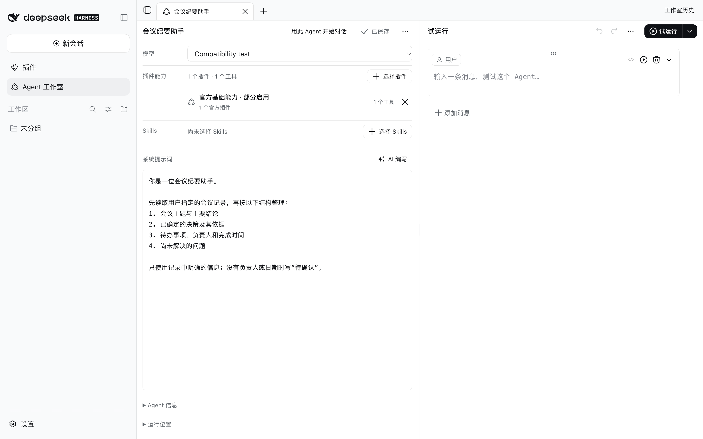
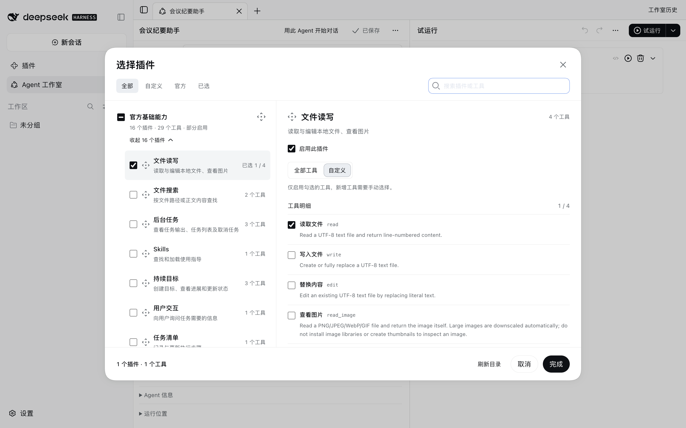
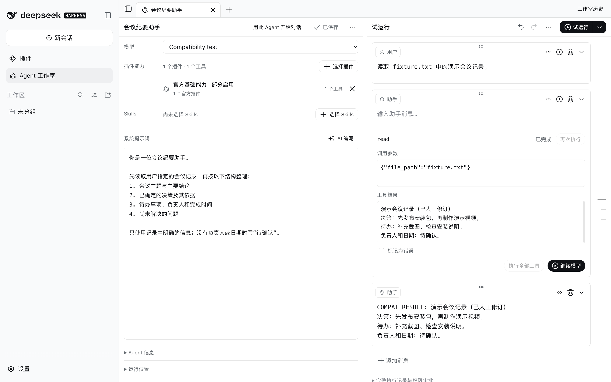

# DSH Agent Studio

Build and test Agents visually in DeepSeek Harness Web: bind tools by plugin, edit tool results during trials, preserve session capability snapshots, and export standalone presets. A guided Agent Creator preset helps draft new Agents in conversation.

[简体中文](README.zh-CN.md) · [Install](#install) · [Downloads](https://github.com/lucky01222/dsh-workbench-agent-studio/releases/latest) · [Changelog](CHANGELOG.md)



## Install

Requires **Node.js 24+** and **DSH Web 0.1.7-rc.2 or 0.2.0-rc.2**. Stop the target Web profile, then run:

```sh
dsh plugin --profile web add https://github.com/lucky01222/dsh-workbench-agent-studio/releases/download/v1.13.3/dsh-workbench-agent-studio-1.13.3.tgz
dsh web
```

The command above installs the prebuilt GitHub Release. When this version is available on npm, you can also install `dsh-workbench-agent-studio@1.13.3` by package name.

Use the same `DSH_HOME` for installation and startup. The application archive includes its service, UI and runtime components; navigation, themes and Library are optional and are not installed by Studio.

You can also download the prebuilt `.tgz` from [GitHub Releases](https://github.com/lucky01222/dsh-workbench-agent-studio/releases/latest) and pass its path to `dsh plugin --profile web add`. Installing a GitHub source checkout is not equivalent: compiled `dist/` files are intentionally not committed.

**Version scope:** Studio **1.13.3**, portable runtime **1.10.5**. Only the two exact DSH versions above are declared compatible. `0.2.1-alpha.5` removes the `both` tool mode and changes PTC behavior; it is not supported by this release. Official macOS Apple Silicon Desktop 0.2.0-rc.2 has also passed the [additional desktop checks](docs/compatibility.md); other desktop builds remain unverified. Desktop installation uses its bundled CLI and `--profile desktop`, not the Web profile.

## Configure, try, revise

1. Open **Agent Studio** in the sidebar. Create an Agent or copy a built-in preset.
2. Choose a chat model, instructions, plugin tools and Skills. Choose all current tools from a plugin or an explicit subset.
3. Trial-run a message. Run tools manually or automatically, edit their results, then continue or rerun. Previous runs remain available in history.
4. Start a normal conversation with the saved Agent, or export its preset for another installation.



Tool ownership follows the actual host registrations. At session start, Studio stores the effective tool set and plugin identities. Existing sessions and historical retries keep their recorded scope; plugin removal or changed ownership is reported rather than silently granting a replacement tool.



Screenshots use an isolated DSH 0.2.0-rc.2 instance, synthetic data and a local scripted model. They illustrate the interface, not the quality of an external model's answers.

## Guided Agent Creator

Choose **Agent 创建助手 / Agent Creator** before starting a conversation. It collects requirements, selects available capabilities, drafts instructions, checks the draft, offers a trial, and saves only after confirmation. Creator tools are scoped to this preset; they are not added to standard mode or unrelated Agents. Creator trials execute read-only tools and record other calls without executing them. Unsaved drafts do not appear in the Studio Agent list.

## What this plugin changes

Studio **disables the official `tools` configuration row** and installs a `ToolRuntime` subclass that records plugin ownership. Tool execution, schema validation, permissions and scope enforcement remain in the official superclass. The original row's configuration is inherited. It also mounts a capability snapshot service and registers saved Agents as presets.

**Other plugins that replace the tool provider or rewrite the same tool layer can conflict.** Check the combined configuration before using them together. Restart the profile after installation, removal or tool-provider configuration changes. Removing the Studio bundle restores the official provider unless another user patch disables it.

## Data and removal

Studio uses official storage domains under the host's configured storage backend (by default **`$DSH_HOME/storages`**):

| Domain | Stored data |
|---|---|
| `workbench_agent_studio` | Agents, revisions, trials, evaluations, tool receipts and prompt drafts |
| `workbench_agent_studio_capabilities` | Session capability snapshots |
| `workbench_agent_studio_library_migrations` | Explicit compatibility-migration receipts; Library is optional |

The default working directory is `$DSH_HOME/workbench-agent-studio/workspace`. Models, credentials and tool providers come from your host. Trial content is sent to the model you select; selected tools act with their host permissions.

```sh
dsh plugin --profile web remove dsh-workbench-agent-studio
```

Restart the profile after removal. The Studio UI/API are removed; saved data are retained and become available after reinstallation. Removing Studio does not delete user files or sessions. Exported presets still need the standalone runtime below.

## Run an exported preset elsewhere

Install the **portable runtime**, the exported Agent's actual tool plugins, and configure its model in the destination host:

```sh
dsh plugin --profile web add https://github.com/lucky01222/dsh-workbench-agent-studio/releases/download/v1.13.3/dsh-workbench-agent-studio-runtime-1.10.5.tgz
dsh web --patch /path/to/exported-agent.yml
```

The export includes the host-level tool registry and snapshot service plus the preset declaration. Do not mount another snapshot service inside every Agent. The destination does not need Studio Service or UI. Remove exported preset patches before removing their runtime.

## Development and verification

```sh
npm ci --ignore-scripts --legacy-peer-deps
npm run build
npm run check
npm test
npm run test:client
DSH_RUNTIME_ROOT=/path/to/official-runtime npm run test:host
npm run pack:release -- ./release
```

`check` checks JavaScript syntax, not full TypeScript types. The host suites were run against official 0.1.7-rc.2 and 0.2.0-rc.2. Clean Web validation covered plugin binding, a real file-tool call, edited tool results, history, runtime-only preset import, removal and reinstall with data preserved. Scripted-model and in-memory-DOM tests do not establish external-model quality or every desktop/browser configuration.

Code is [MIT licensed](LICENSE). Bundled and adapted third-party code is attributed in [THIRD_PARTY_NOTICES.md](THIRD_PARTY_NOTICES.md).
